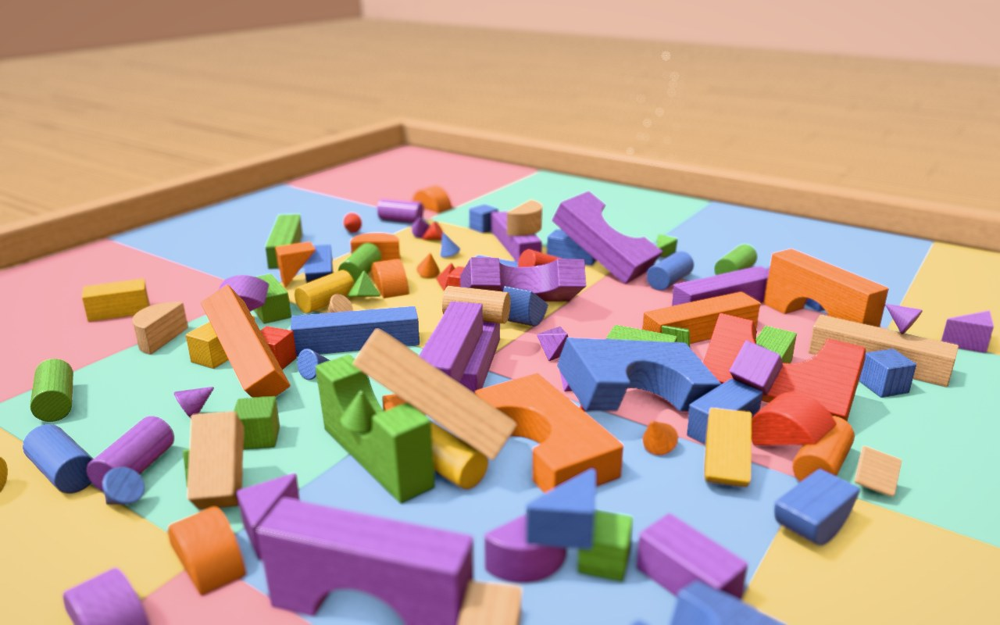
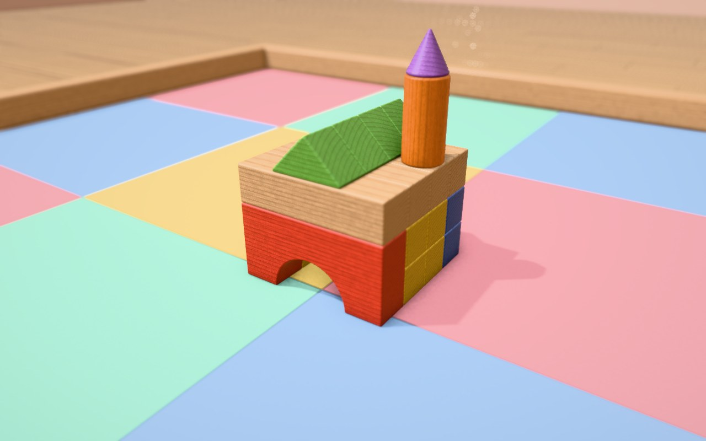
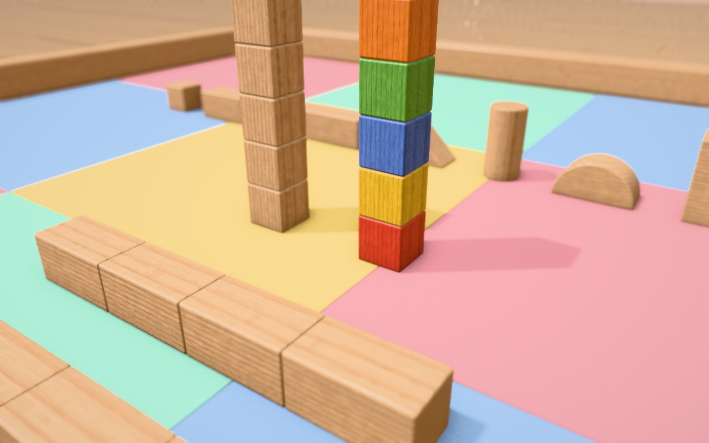
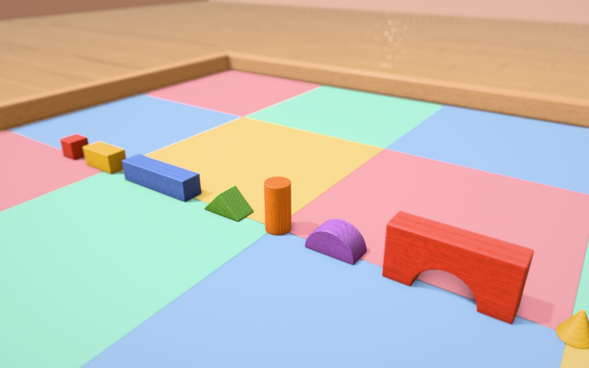

# WOODYN — Real Wood. Real Physics.

**A real-time 3D wooden toy block simulator.** Pick up stained solid-wood
blocks in a cozy playroom, stack them, build houses and towers, knock them
over and hear them clack — with rigid-body physics tuned for 3 cm blocks and
a physically based renderer that draws every block's own, continuous wood
grain.



| | |
| --- | --- |
|  |  |
|  | *Left to right, top to bottom: a toy house, grain that continues across blocks cut from one log, the nine block shapes.* |

> **License:** free for personal, educational and research use;
> **commercial use requires a paid license** — see [License](#license).

## Features

**Physics** (Jolt Physics, retuned for small objects)
- 480 Hz fixed-step rigid-body simulation: 15-cube towers stand, ~1,000 blocks at 60 fps
- Nine block shapes on a 3 cm module (cube, brick, beam, roof, cylinder, half
  cylinder, arch, cone, pyramid) with 1.5 mm rounded edges in both collision and rendering
- Wood species with physical properties (density, friction, restitution, rolling resistance)
- Soft EVA foam play mat that absorbs impacts — blocks land with a dull "thud" instead of rocking
- Enclosed play area: blocks can be thrown but never leave it (verified up to 30 m/s)
- Deterministic simulation (same build), undo/redo snapshots

**Wood** (the signature feature)
- Every block is *cut from a virtual log*: a 3D procedural grain field with
  growth rings, latewood, medullary rays and ring-porous pores
- Blocks cut next to each other continue each other's grain; grain never
  slides when blocks move
- End grain detected from the fiber direction; stains soak deeper into it
- Colorful stains over the wood, with the grain showing through
- CC0 photographic micro detail (pores, fine fibers) aligned with the grain

**Rendering** (SDL3 GPU API on Vulkan)
- PBR (GGX) with a clear-coat lacquer layer, image-based lighting
- 4096² sun shadow map with soft PCF, SSAO and screen-space contact shadows
- MSAA 4×, HDR, bloom, "tilt-shift" depth of field, Khronos PBR Neutral tone mapping
- Software fallback renderer for machines without Vulkan

**Play**
- Physics-based grab-and-drag with a natural grip, drop preview, throwing
- Rotate held blocks in 1° steps (hold to keep turning) or 90° steps
- Toy shelf UI, color swatches, keyboard + mouse controls, fullscreen
- Modal-synthesis impact sounds: every block rings with its own size-dependent pitch

## Requirements

- Linux (developed on Ubuntu 24.04)
- A Vulkan-capable GPU (reference: NVIDIA GeForce RTX 3060) — optional, a software renderer is built in
- Clang 23 (primary) or GCC 13, CMake ≥ 3.30, Ninja
- Vulkan SDK (for `glslc`, which compiles the shaders)
- SDL3 build dependencies (X11/Wayland/audio `-dev` packages, see SDL's
  [README-linux](https://github.com/libsdl-org/SDL/blob/main/docs/README-linux.md))

All libraries (Jolt, SDL3, GLM, spdlog, GoogleTest, stb_image) are downloaded
and SHA-256 verified by CMake at configure time.

## Build

```bash
git clone https://github.com/TechieQuokka/woodyn-engine.git
cd woodyn-engine
cmake --preset clang-release        # or clang-debug / gcc-debug
cmake --build --preset clang-release
ctest --preset clang-release        # 137 tests (GPU tests skip without Vulkan)
```

The presets expect `clang++-23` in `/usr/bin` and `ninja` in `/usr/local/bin`;
adjust `CMakePresets.json` for other locations.

## Run

```bash
./build/clang-release/apps/viewer/woodyn_viewer                    # playroom with a toy house
./build/clang-release/apps/viewer/woodyn_viewer --scene pile       # also: tower, showcase, grain, empty
./build/clang-release/apps/viewer/woodyn_viewer --renderer soft    # software renderer
```

Headless tools:

```bash
# Physics benchmark / tuning
./build/clang-release/apps/bench/woodyn_bench --scene pile --count 1000 --seconds 10
# Render impact sounds to a WAV file
./build/clang-release/apps/bench/woodyn_bench --scene drops --seconds 8 --wav drops.wav
```

## Controls

| Input | Action |
| ----- | ------ |
| Left-drag a block | pick it up and carry it |
| Bottom shelf | press a shape to take a new block; swatches pick the color; `Tab` hides the shelf |
| While holding: Shift+mouse or wheel | raise / lower |
| While holding: `Q` / `E` turn, `R` / `F` tip | tap = 1°, hold = keep turning, Shift = 90° |
| While holding: Ctrl+wheel / Ctrl+mouse / Ctrl+Shift+mouse | 1° per notch / free turn / fine turn |
| While holding: hold `Space` | gently align to a square orientation |
| Release | drop or throw (a blue ghost previews where it lands) |
| `W` `A` `S` `D` · right-drag · middle-drag · wheel | move · orbit · pan · zoom the camera |
| `1`–`9` | new block at the cursor |
| `C` / `O` | recolor the held or hovered block / beech ↔ oak |
| `F2`–`F6` · `Delete` | scenes (tower, house, showcase, pile, grain) · clear |
| `Ctrl+Z` / `Ctrl+Y` | undo / redo |
| `F7` `F8` `F9` `F10` | depth of field · AO + contact shadows · bloom · photo wood detail |
| `F11` · `P` · `M` · `F1` · `Esc` | fullscreen · pause · mute · help · quit |

## Project layout

```text
engine/      simulation core: physics (Jolt), blocks, wood (logs, cuts, grain), audio synthesis
renderer/    GPU renderer (SDL3 GPU API / Vulkan) and GLSL shaders
apps/viewer/ interactive playroom (GPU renderer, software fallback)
apps/bench/  headless benchmark, tuning and sound rendering
tests/       GoogleTest suites (physics validation, grain continuity, GPU parity)
assets/      CC0 texture assets
tools/       asset processing scripts
docs/        design document with the full decisions log
```

The design and every technical decision (with measurements) are documented in
[docs/DESIGN.md](docs/DESIGN.md), section 15.

## License

Copyright (c) 2026 TechieQuokka.

WOODYN is **source-available** under the
[PolyForm Noncommercial License 1.0.0](LICENSE):

- ✅ **Free** for personal use, hobby projects, study, research and
  experimentation, and for use by educational institutions, charities, public
  research organizations and government institutions.
- 💼 **Commercial use requires a paid commercial license.** This includes using
  WOODYN or any part of it in a product, service or work done for a company.
  To obtain a commercial license, please open an issue titled
  *"Commercial license"* in this repository or contact
  [@TechieQuokka](https://github.com/TechieQuokka) on GitHub.

Third-party libraries and assets keep their own licenses — see
[THIRD_PARTY.md](THIRD_PARTY.md).
